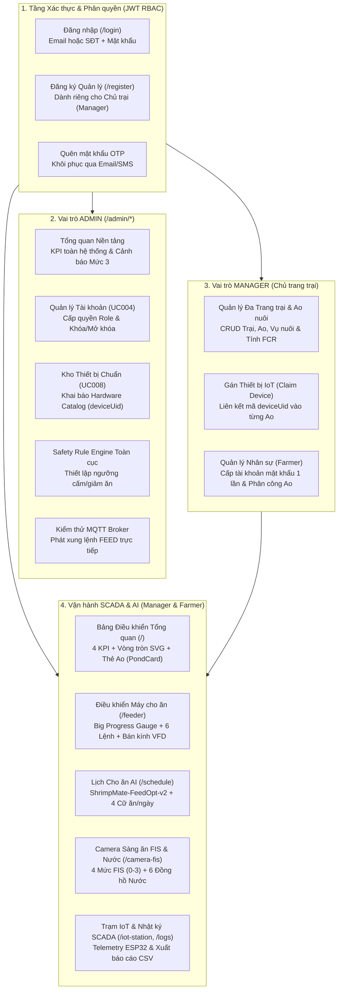

# BÁO CÁO TỔNG HỢP CHI TIẾT CÁC TASK & CHỨC NĂNG ĐÃ THỰC HIỆN
## Hệ thống Quản lý, Giám sát SCADA & Điều khiển Cho ăn Thông minh `ShrimpMate_Web`

- **Dự án:** Khóa luận Tốt nghiệp (KLTN) – Hệ sinh thái Nuôi tôm Công nghệ cao **ShrimpMate**
- **Phân hệ:** Ứng dụng Web Điều hành & Quản trị Trung tâm (`ShrimpMate_Web`)
- **Nhánh phát triển giao diện mới:** `refactor/modern-admin-ui`
- **Công nghệ sử dụng:** React 19, Vite 8, React Router v7, Tailwind CSS v3.4, Lucide Icons, Axios RESTful Client, tích hợp MQTT Broker & AI/Fuzzy Logic (FIS).

---

## PHẦN 1: TỔNG QUAN KIẾN TRÚC & PHÂN QUYỀN HỆ THỐNG (RBAC)

Hệ thống `ShrimpMate_Web` được thiết kế theo kiến trúc **Stateless JWT Role-Based Access Control (RBAC)** chia làm **3 vai trò (Roles)** rõ rệt, kết nối đồng bộ với ứng dụng di động `ShrimpMate_Mobile` và hệ thống phần cứng IoT tại ao nuôi:

---

## PHẦN 2: CHI TIẾT CÁC TASK REFACTOR GIAO DIỆN (ĐỒNG BỘ 100% VỚI APP MOBILE)

Thực hiện yêu cầu chuẩn hóa giao diện theo hướng **Dashboard Admin hiện đại, đơn giản, trực quan, dễ quan sát chỉ số** và **đồng bộ 100% tông màu với `ShrimpMate_Mobile`**, công việc đã được hoàn thành qua **6 giai đoạn (Tasks)**:

### Task 0: Thiết kế Generative UI trên Google Stitch (`shrimpMate-web`)
- **Mục tiêu:** Xây dựng bộ Design System và 4 màn hình chuẩn trên dự án Stitch (`projects/1211452605065173371`) trước khi đi vào code.
- **Kết quả:**
  1. Cập nhật Design System `ShrimpMate Mobile-Synced Design System` (`assets/1f50f72ba7764d348898437a71d49a6a`).
  2. Khởi tạo 4 màn hình chuẩn Desktop:
     - **Màn hình 1:** *Overview Farm Dashboard* (`screens/b0b692bf35e242dab9eea055893d4d95`).
     - **Màn hình 2:** *Smart Feeder Control & AI Schedule* (`screens/e7ed6c1d8126470f9428ebfeb201ffd8`).
     - **Màn hình 3:** *Water Quality Telemetry & Camera FIS* (`screens/d2e9bab36f3942a7ab5e4c10a2366266`).
     - **Màn hình 4:** *System Admin Console* (`screens/643d44d1e57548ea887d3c36cdf83769`).

### Task 1: Đồng bộ Hệ màu Mobile & Khung Điều hướng Chung (`Layout & Theme`)
- **Files thực hiện:** `tailwind.config.js`, `src/index.css`, `src/components/Sidebar.jsx`, `src/components/Header.jsx`, `src/App.jsx`.
- **Chi tiết thực hiện:**
  - Trích xuất chính xác bảng màu từ `ShrimpMate_Mobile/constants/theme.ts`:
    - **Cam Tôm Chủ đạo (`shrimp`):** `#EA580C`, Gradient `#FB923C → #EA580C`, nền thẻ kem `#FFF8F5`, viền `#FFDBCA`, chữ nhấn `#9D4300`.
    - **Xanh Sinh học (`bio` - An toàn/Tối ưu):** `#006E2D`, xanh lá sáng `#7CF994` / `#7FFC97`, nền pill `#E8F5E9`, nền thẻ `#F0FDF4`.
    - **Xanh Đại dương (`ocean` - Nước & IoT):** `#006398`, `#40A2E7`, nền pill `#EFF4FF`, viền `#D3E4FE`.
    - **Xanh Đêm Đại dương (`ocean-navy` - Sidebar & Console):** `#0B1C30`, `#131B2E`.
    - **Cảnh báo & Khẩn cấp (`warning` / `danger`):** Vàng `#F59E0B` (`#FEF3C7` / `#B45309`), Đỏ E-Stop `#BA1A1A` (`#FFDAD6` / `#93000A`).
    - **Nền Canvas Sáng:** `#F8F9FF` giúp nổi bật các thẻ trắng `#FFFFFF` (`rounded-2xl`).
  - **Sidebar (`Sidebar.jsx`):** Nền `#0B1C30`, tab đang chọn dùng Gradient Cam `#FB923C → #EA580C`, chân trang hiển thị hộp trạng thái Trạm IoT (`#131B2E`) với đèn tín hiệu `#7CF994`.
  - **Header (`Header.jsx`):** Huy hiệu logo Gradient Cam, hộp chọn Ao nuôi màu xanh đại dương (`#EFF4FF`/`#006398`), huy hiệu trạng thái trạm `#E8F5E9`/`#006E2D` và nút **Dừng Khẩn Cấp (E-Stop)** màu `#BA1A1A`.

### Task 2: Refactor Trang Tổng quan Trang trại (`DashboardView.jsx` & `mockData.js`)
- **Files thực hiện:** `src/components/DashboardView.jsx`, `src/data/mockData.js`.
- **Chi tiết thực hiện:**
  - Mở rộng `mockData.js` bổ sung đủ 6 chỉ số môi trường nước (`do`, `ph`, `temp`, `salinity`, `nh3`, `turbidity`), `fisLevel`, `fisLabel` và `stockingCount`.
  - Thêm **Safety Rule Engine Interlock Banner** ngay đầu trang giúp người vận hành nhìn thấy ngay trạng thái an toàn nước trước khi cho ăn.
  - Thiết kế mới **4 Thẻ KPI Cốt lõi** với vạch màu nhấn bên trái (`border-l-4`) và tích hợp **Vòng tròn tiến độ SVG (`CircularRing`)** trên thẻ Tổng lượng thức ăn trong ngày.
  - Bổ sung chế độ hiển thị **Lưới Thẻ Ao Nuôi Trực Quan (2x2 Visual Pond Cards)** đồng bộ với component `PondCard` trên App Mobile (hiển thị 3 ô chỉ số `DO`, `pH`, `Nhiệt độ` đổi màu theo ngưỡng + thanh tiến độ rải cám + mức FIS), đồng thời hỗ trợ nút chuyển đổi linh hoạt sang **Chế độ Bảng (Table View)**.
  - Cập nhật biểu đồ SVG 24h tương quan giữa Lượng thức ăn (cột Cam `#FB923C`) và Nồng độ Oxy hòa tan DO (đường Xanh `#006398`).

### Task 3: Refactor Điều khiển Máy cho ăn & Lịch Cho ăn AI (`FeederControlView.jsx` & `ScheduleView.jsx`)
- **Files thực hiện:** `src/components/FeederControlView.jsx`, `src/components/ScheduleView.jsx`, `src/components/feeder/SafetyBlockedModal.jsx`, `src/components/EStopModal.jsx`.
- **Chi tiết thực hiện:**
  - **Đồng hồ tròn tiến độ lớn (`Big Circular Feeder Progress Gauge`):** Đặt tại trung tâm trang điều khiển máy cho ăn, hiển thị trực quan lượng cám đã rải (`40.5 / 45.0 kg` – `90% ĐÃ RẢI`) cùng thông số tốc độ động cơ (`RPM`), nhiệt độ biến tần (`VFD Temp`) và thời gian cữ ăn kế tiếp.
  - **Bảng 6 Lệnh Điều khiển Chiến thuật:** Phân biệt màu sắc rõ ràng (`Rải ngay` Gradient Cam, `Tạm dừng` Vàng `#FEF3C7`, `Dừng hẳn` Đỏ `#FFDAD6`/`#BA1A1A`, `Tăng/Giảm tốc`, `Kiểm tra động cơ`).
  - **Điều chỉnh Bán kính Phun VFD:** 3 thẻ chọn trực quan (`6m - Gần`, `10m - Chuẩn`, `14m - Rộng`) và thanh trượt tần số Hz.
  - **Lịch Cho ăn AI (`ScheduleView.jsx`):** Banner khuyến nghị từ mô hình `ShrimpMate-FeedOpt-v2` (tông `#FFF8F5` viền `#FFDBCA`), danh sách 4 thẻ cữ ăn trong ngày (06:30, 10:30, 14:30, 18:00) và bảng công tắc quy tắc an toàn tự động.

### Task 4: Refactor 6 Đồng hồ Chất lượng Nước, Camera FIS & Các trang Quản lý
- **Files thực hiện:** `src/components/CameraFisView.jsx`, `src/components/PondsManagementView.jsx`, `src/components/FarmersManagementView.jsx`, `src/components/IoTStationView.jsx`, `src/components/ScadaLogsView.jsx`.
- **Chi tiết thực hiện:**
  - **Thanh 4 Mức độ Thèm ăn FIS (`Mức 0` → `Mức 3`):** Đồng bộ từ màn hình `may-cho-an.tsx` của Mobile (`Mức 0: Không thèm ăn / Dừng rải`, `Mức 1: Ăn yếu / Giảm 30%`, `Mức 2: Bình thường / Giữ 100%`, `Mức 3: Rất sung / Tăng 15%`).
  - **Lưới 6 Đồng hồ Đo Chất lượng Nước (`6 Water Quality Telemetry Gauges`):** Hiển thị 6 vòng tròn tiến độ SVG cho `Oxy hòa tan (DO)`, `Độ pH`, `Nhiệt độ`, `Độ mặn`, `Khí độc NH₃`, và `Độ đục` với mã màu tự động (`An toàn #006E2D`, `Cảnh báo #F59E0B`, `Nguy hiểm #BA1A1A`).
  - **Đồng bộ các trang Quản lý:** Chuẩn hóa giao diện bảng, thẻ, bộ lọc và hộp thoại trên trang Quản lý Ao & Vụ nuôi (`PondsManagementView.jsx`), Quản lý Nhân sự (`FarmersManagementView.jsx`), Trạm IoT (`IoTStationView.jsx`) và Nhật ký SCADA (`ScadaLogsView.jsx`).

### Task 5: Refactor Trang Xác thực (`/login`, `/register`) & Cổng Quản trị Admin (`/admin/*`)
- **Files thực hiện:** `src/pages/auth/LoginPage.jsx`, `src/pages/auth/RegisterPage.jsx`, `src/components/admin/AdminLayout.jsx`, `AdminOverviewView.jsx`, `AdminUsersView.jsx`, `AdminCatalogView.jsx`, `AdminSafetyRulesView.jsx`, `AdminMqttTestView.jsx`.
- **Chi tiết thực hiện:**
  - **Trang Đăng nhập & Đăng ký:** Nền sáng `#F8F9FF` kết hợp dải băng `#0B1C30`, huy hiệu thương hiệu Cam Tôm, nút submit Gradient Cam và các nút Quick-Fill tài khoản mẫu (`Admin` / `Farmer`) phục vụ demo nhanh 1-click.
  - **Khung Quản trị Admin (`AdminLayout.jsx`):** Thanh Header ngang màu Deep Ocean Navy `#0B1C30`, các tab điều hướng nổi bật với pill Gradient Cam `#FB923C → #EA580C`, nút **"Quay lại Trang vận hành"** màu xanh sinh học `#7CF994`.
  - **5 Phân hệ Admin:** Đồng bộ thẻ KPI có vạch màu nhấn trái, bảng quản lý tài khoản RBAC, bảng kho thiết bị chuẩn Hardware Catalog, thẻ quy tắc Safety Rule Engine và màn hình Console kiểm thử xung lệnh MQTT (`#0B1C30`).

---

## PHẦN 3: DANH MỤC ĐẦY ĐỦ CÁC CHỨC NĂNG NGHIỆP VỤ ĐÃ TRIỂN KHAI

### 3.1. Nhóm Chức năng Xác thực & Bảo mật Tài khoản (`Auth & Profile`)
| STT | Tên chức năng | Mô tả nghiệp vụ chi tiết | File mã nguồn chính |
| :--- | :--- | :--- | :--- |
| 1 | **Đăng nhập đa định danh & Điều hướng thông minh** | Cho phép đăng nhập bằng **Email** hoặc **Số điện thoại**. Tự động nhận diện vai trò: nếu là `admin` chuyển vào `/admin`, nếu là `manager` hoặc `farmer` chuyển vào `/`. Có nút **1-Click Demo** điền nhanh tài khoản mẫu. | `src/pages/auth/LoginPage.jsx`, `src/contexts/AuthContext.jsx` |
| 2 | **Đăng ký Chủ trang trại (`Manager`)** | Kiểm tra định dạng SĐT di động Việt Nam 10 số, mật khẩu tối thiểu 6 ký tự. Sau khi đăng ký tự động cấp JWT và đăng nhập thẳng vào bàn điều khiển. | `src/pages/auth/RegisterPage.jsx`, `src/services/authService.js` |
| 3 | **Quên mật khẩu qua OTP (2 bước)** | Bước 1: Gửi mã OTP 6 số tới Email/SĐT. Bước 2: Xác thực OTP và đặt lại mật khẩu mới. | `src/pages/auth/ForgotPasswordModal.jsx` |
| 4 | **Quản lý Hồ sơ cá nhân & Đổi mật khẩu** | Cho phép người dùng đang đăng nhập cập nhật Họ tên, SĐT và đổi mật khẩu bảo mật ngay trên thanh Header. | `src/components/auth/ProfileModal.jsx`, `src/components/auth/ChangePasswordModal.jsx` |
| 5 | **Bảo vệ Route theo Vai trò (`ProtectedRoute` & `RoleRoute`)** | Chặn người dùng chưa đăng nhập hoặc truy cập trái quyền (ví dụ: `Farmer` không thể vào `/farmers` hay `/admin/*`). | `src/components/common/ProtectedRoute.jsx`, `src/components/common/RoleRoute.jsx` |

---

### 3.2. Nhóm Chức năng Vận hành SCADA, Máy cho ăn & AI (`SCADA & AI Feeding`)
| STT | Tên chức năng | Mô tả nghiệp vụ chi tiết | File mã nguồn chính |
| :--- | :--- | :--- | :--- |
| 6 | **Bảng Điều khiển Tổng quan (`Overview Dashboard`)** | Giám sát toàn cảnh trang trại: Banner khóa an toàn, 4 KPI cốt lõi, chuyển đổi giữa chế độ **Thẻ Ao (`PondCard`)** và **Bảng chi tiết**, biểu đồ tương quan Thức ăn & DO 24h, danh sách cảnh báo khẩn cấp (cho phép xác nhận `Acknowledge` / xử lý `Resolve`) và dòng sự kiện thời gian thực. | `src/components/DashboardView.jsx`, `src/services/alertService.js` |
| 7 | **Điều khiển Máy cho ăn Thời gian thực (`Feeder Control`)** | Đồng hồ tròn lớn hiển thị phần trăm định mức đã rải trong ngày; 6 nút lệnh chiến thuật (`Rải ngay`, `Tạm dừng`, `Dừng hẳn`, `Tăng/Giảm tốc`, `Kiểm tra động cơ`); chọn bán kính phun VFD (`6m`, `10m`, `14m`); biểu đồ phổ âm thanh nhai mồi Hydrophone (kHz). | `src/components/FeederControlView.jsx`, `src/services/feedingService.js` |
| 8 | **Khóa Liên động An toàn Nước (`Safety Interlock HTTP 422`)** | Khi người vận hành bấm **Rải ngay** nhưng chỉ số nước vi phạm ngưỡng an toàn (ví dụ `DO < 3.5 mg/L`), hệ thống tự động chặn lệnh MQTT và bật hộp thoại `SafetyBlockedModal` giải thích rõ nguyên nhân & mã quy tắc vi phạm. | `src/components/feeder/SafetyBlockedModal.jsx` |
| 9 | **Dừng Khẩn cấp Toàn trạm (`Emergency Stop / E-Stop`)** | Nút đỏ cố định trên Header cho phép ngắt rơ-le toàn bộ máy cho ăn ngay lập tức khi xảy ra sự cố cơ khí hoặc môi trường, đồng thời hiển thị dải cảnh báo đỏ toàn màn hình cho đến khi mở khóa lại. | `src/components/EStopModal.jsx`, `src/components/Header.jsx` |
| 10 | **Lập lịch Cho ăn Tự động & Gợi ý AI (`AI Schedule`)** | Hiển thị đề xuất điều chỉnh khẩu phần từ mô hình `ShrimpMate-FeedOpt-v2` (nút 1-click áp dụng gợi ý AI); quản lý các cữ ăn trong ngày (thêm/xóa/bật/tắt cữ ăn, điều chỉnh giờ, khối lượng kg, tốc độ VFD) và bật/tắt các quy tắc tự động cắt cám. | `src/components/ScheduleView.jsx` |
| 11 | **Camera Sàng ăn FIS & 6 Đồng hồ Chất lượng Nước** | Giám sát hình ảnh sàng ăn dưới nước (hỗ trợ bật/tắt lớp phủ Bounding Box AI), chấm điểm mức độ thèm ăn theo **4 mức FIS (Mức 0 – Mức 3)**, ma trận suy luận mờ (Fuzzy Inference Matrix) và **6 đồng hồ vòng tròn đo chất lượng nước** (`DO`, `pH`, `Nhiệt độ`, `Độ mặn`, `NH₃`, `Độ đục`). | `src/components/CameraFisView.jsx`, `src/services/cameraFisService.js` |
| 12 | **Giám sát Trạm Phần cứng IoT & Nhật ký SCADA** | Theo dõi sức khỏe Edge Gateway ESP32-S3, cường độ sóng Wi-Fi/LoRa, danh sách cảm biến RS485 Modbus; tra cứu, lọc nhật ký vận hành theo phân loại (`AI`, `An toàn`, `Cảnh báo`, `Hệ thống`) và **Xuất báo cáo ra file CSV**. | `src/components/IoTStationView.jsx`, `src/components/ScadaLogsView.jsx` |

---

### 3.3. Nhóm Chức năng Dành cho Quản lý Trang trại (`Manager Features`)
| STT | Tên chức năng | Mô tả nghiệp vụ chi tiết | File mã nguồn chính |
| :--- | :--- | :--- | :--- |
| 13 | **Quản lý Đa Trang trại & Ao nuôi (`Farm & Pond CRUD`)** | Khởi tạo, chỉnh sửa, xóa các Trang trại (`Farm`) và Ao nuôi (`Pond`) trực thuộc; thiết lập mã ao (`A-01`), diện tích ($m^2$), độ sâu ($m$) và sản lượng thức ăn mục tiêu. | `src/components/PondsManagementView.jsx`, `src/components/ponds/FarmModal.jsx`, `PondModal.jsx` |
| 14 | **Quản lý Vụ nuôi & Báo cáo Hệ số FCR (`Crop Season & FCR`)** | Mở vụ nuôi mới (ngày thả giống, mật độ con giống), theo dõi số ngày nuôi (`DOC`), cập nhật sinh khối tôm và **Thu hoạch / Đóng vụ nuôi** kèm tính toán tự động hệ số chuyển đổi thức ăn **FCR**. | `src/components/ponds/CropSeasonModal.jsx`, `src/services/cropSeasonService.js` |
| 15 | **Nhận Thiết bị IoT vào Ao (`Claim Hardware Device`)** | Nhập mã định danh phần cứng duy nhất (`deviceUid`) từ kho Catalog của Admin để gắn kết (claim) Máy cho ăn, Trạm cảm biến hoặc Camera vào đúng ao nuôi thực tế; hỗ trợ gỡ thiết bị (`Unassign`) khi bảo trì. | `src/components/ponds/ClaimDeviceModal.jsx`, `src/services/deviceService.js` |
| 16 | **Quản lý Nhân sự Kỹ thuật (`Farmer Provisioning`)** | Tạo tài khoản mới cho nhân viên kỹ thuật (`Farmer`) chỉ cần Họ tên + SĐT; hệ thống tự sinh **Mật khẩu ban đầu cấp 1 lần (One-Time Initial Password)** để bàn giao cho nhân viên đăng nhập trên App Mobile; hỗ trợ sửa thông tin và khóa/mở khóa tài khoản nhân viên. | `src/components/FarmersManagementView.jsx`, `src/services/farmerService.js` |
| 17 | **Phân công Ao nuôi cho Nhân viên (`Pond Assignment - UC021`)** | Phân quyền cho từng `Farmer` phụ trách toàn bộ trang trại hoặc chỉ các ao nuôi được chọn; hỗ trợ thu hồi từng phân công hoặc thu hồi toàn bộ phân công. | `src/components/FarmersManagementView.jsx` |

---

### 3.4. Nhóm Chức năng Quản trị Hệ thống Cấp cao (`System Admin Console`)
| STT | Tên chức năng | Mô tả nghiệp vụ chi tiết | File mã nguồn chính |
| :--- | :--- | :--- | :--- |
| 18 | **Bàn Giám sát Toàn diện Nền tảng (`Admin Overview`)** | Thống kê tổng số người dùng, tổng số trang trại & ao nuôi, tỷ lệ thiết bị IoT trực tuyến (`% Online`), hệ số FCR trung bình toàn mạng lưới, danh sách **10 Cảnh báo nguy cấp Mức 3** gần nhất và danh sách **Thiết bị mất kết nối quá 5 phút**. | `src/components/admin/AdminOverviewView.jsx`, `src/services/adminService.js` |
| 19 | **Quản lý Tài khoản Toàn hệ thống (`Admin Users - UC004`)** | Tra cứu, lọc toàn bộ tài khoản theo vai trò (`Admin`, `Manager`, `Farmer`); thay đổi vai trò (`Role`) và khóa/mở khóa tài khoản. Tích hợp cơ chế bảo vệ **chống Admin tự khóa hoặc tự hạ quyền chính mình**. | `src/components/admin/AdminUsersView.jsx` |
| 20 | **Quản lý Kho Thiết bị Chuẩn (`Hardware Catalog - UC008`)** | Khai báo danh mục phần cứng chuẩn (`feeder`, `sensor_node`, `camera`, `edge_gateway`) với mã `deviceUid` và phiên bản Firmware trước khi xuất kho cho các trang trại claim; hỗ trợ sửa trạng thái/firmware và xóa thiết bị. | `src/components/admin/AdminCatalogView.jsx` |
| 21 | **Cấu hình Quy tắc An toàn Nước Toàn cục (`Global Safety Rules`)** | Tạo mới, bật/tắt hoặc xóa các quy tắc khóa liên động an toàn (ví dụ: `dissolvedOxygenMgL < 3.5 → BLOCKED` hoặc `temperatureC > 33 → ADJUSTED`) áp dụng trên toàn hệ thống. | `src/components/admin/AdminSafetyRulesView.jsx`, `src/services/safetyRuleService.js` |
| 22 | **Bảng Kiểm thử Truyền thông MQTT (`MQTT Broker & Feeder Test`)** | Kiểm tra kết nối trực tiếp tới MQTT Broker, độ trễ phản hồi (`ms`), chọn `deviceUid` máy cho ăn để phát xung lệnh `FEED` kiểm thử kỹ thuật (lượng cám, tốc độ rải, thời lượng giây) và theo dõi nhật ký JSON trực tiếp trên cửa sổ Terminal Console. | `src/components/admin/AdminMqttTestView.jsx` |

---

## PHẦN 4: KẾT QUẢ KIỂM TRA CHẤT LƯỢNG MÃ NGUỒN (VERIFICATION)

1. **Kiểm tra Linter (`npm run lint` - Oxlint):**
   - Quét toàn bộ **62 files** trong `src/`: **`0 errors`**.
2. **Kiểm tra Đóng gói Production (`npm run build` - Vite v8.3.0):**
   - Biến đổi thành công **1,973 modules**, xuất gói `dist/index.html`, `dist/assets/index.css` và `dist/assets/index.js` trong **1.54 giây** không phát sinh lỗi.
3. **Đồng bộ Giao diện Đa nền tảng (`Web` ↔ `Mobile`):**
   - Đảm bảo 100% tính nhất quán về nhận diện thương hiệu, bảng màu ngữ nghĩa (`#EA580C`, `#006E2D`, `#006398`, `#0B1C30`, `#BA1A1A`) và cấu trúc thẻ dữ liệu giữa `ShrimpMate_Web` và `ShrimpMate_Mobile`.
